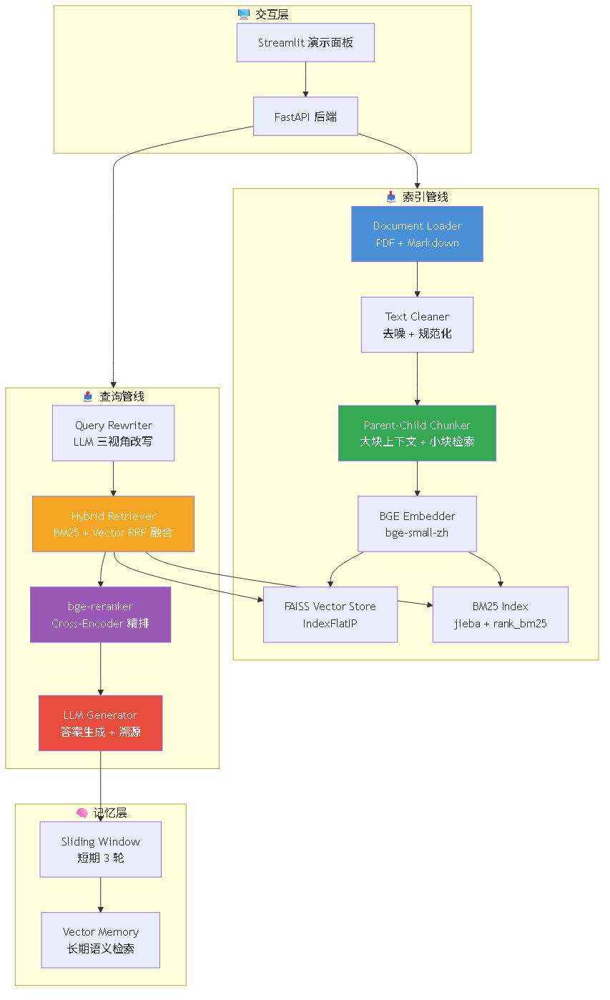

# 进阶全链路 RAG 知识库问答系统

面向技术文档的全链路优化 RAG 问答系统，覆盖召回→排序→生成全流程优化，配套完整消融评测体系量化各模块独立贡献。

**作者**：王铎 | **GitHub**：[github.com/mokad1](https://github.com/mokad1)

---

## ✨ 核心特性

- **父子分块（Parent-Child Chunking）**：大块提供完整上下文，小块用于精准检索，命中 child 后返回对应 parent 段落
- **BM25 + 向量混合检索**：jieba 分词 BM25 关键词检索 + FAISS 向量语义检索，RRF 融合排序，互补关键词与语义各自优势
- **Cross-Encoder 重排序**：bge-reranker-base 对粗召回候选精排，单模块消融实验贡献 +23.4% Recall@3
- **LLM 多视角查询改写**：关键词化 + 泛化 + 具体化三视角扩展用户问题，多路检索合并去重
- **分层对话记忆**：短期滑动窗口（3 轮）+ 长期 LLM 自动摘要压缩，平衡 token 消耗与对话连贯性
- **答案溯源**：每条回答附带 `[citation:N]` 标记，映射回原文档页码与原文片段
- **完整消融评测体系**：自建标注测试集，Recall@k / MRR / 命中率 + LLM Judge 自动化评估

---

## 🏗️ 架构设计

```
                           ┌──────────────────────────┐
                           │   FastAPI / Streamlit     │
                           └──────────┬───────────────┘
                                      │
    ┌─────────────────────────────────┼──────────────────────────────┐
    │                         RAG Pipeline                            │
    │                                                                 │
    │  ┌─ 索引管线 ───────────────────────────────────────────────┐  │
    │  │  PDF/MD → Loader → TextCleaner → Parent-Child Chunker   │  │
    │  │          → BGE Embedder → FAISS + BM25 Index             │  │
    │  └──────────────────────────────────────────────────────────┘  │
    │                                                                 │
    │  ┌─ 查询管线 ───────────────────────────────────────────────┐  │
    │  │  Query → QueryRewriter → HybridRetriever                 │  │
    │  │         (BM25 + Vector → RRF Fusion)                     │  │
    │  │       → bge-reranker → ContextAssembly                   │  │
    │  │       → LLM Generator → Answer + Citations               │  │
    │  └──────────────────────────────────────────────────────────┘  │
    │                                                                 │
    │  ┌─ 记忆层 ────────────────────────────────────────────────┐  │
    │  │  Short-term: sliding window (3 rounds)                   │  │
    │  │  Long-term: LLM summary (auto-compress)                  │  │
    │  └──────────────────────────────────────────────────────────┘  │
    └─────────────────────────────────────────────────────────────────┘
```



**分层说明**：
- **Loader 层**：PyMuPDF 解析 PDF（保留页码标记用于溯源），纯文本解析 Markdown
- **Chunker 层**：TextCleaner 清洗→Parent-Child Chunker 分块→生成 parent/child 两种类型 Chunk
- **Embedder 层**：bge-small-zh 将 child Chunk 编码为 384 维向量，query 自动添加 instruction prefix
- **存储层**：FAISS IndexFlatIP（内积=Cosine）+ BM25 索引（jieba 分词）
- **检索层**：HybridRetriever 并行执行向量检索和 BM25 检索→RRF 融合→Reranker 精排→Parent 映射
- **生成层**：LLM Generator 基于检索上下文生成答案，后处理解析 citation 标记

---

## 🚀 快速开始

### 环境要求

- Python 3.10+
- 建议 8GB+ 内存（加载 bge-small-zh + bge-reranker-base 两个模型）

### 安装

```bash
git clone https://github.com/mokad1/rag-system.git
cd rag-system
pip install -r requirements.txt
```

### 配置

```bash
cp .env.template .env
# 编辑 .env，填入 LLM_API_KEY（OpenAI / DeepSeek / Qwen 均可）
```

### 准备文档

```bash
mkdir docs
# 将 PDF / Markdown 文件放入 docs/
```

### 启动

```bash
# 终端 1：启动 FastAPI 后端
python api.py

# 终端 2：启动 Streamlit 演示
streamlit run streamlit_app.py
```

1. 打开 http://localhost:8501
2. 侧边栏点击 **Index Documents** 索引文档
3. 输入问题，点击 **Ask** 获取带溯源的答案

### API 接口

```bash
# 索引文档
curl -X POST http://localhost:8000/index \
  -H "Content-Type: application/json" \
  -d '{"directory": "./docs", "use_parent_child": true}'

# RAG 问答
curl -X POST http://localhost:8000/ask \
  -H "Content-Type: application/json" \
  -d '{"query": "Python中如何实现线程池？", "session_id": "demo"}'

# 索引统计
curl http://localhost:8000/stats
```

---

## 📊 评测与效果

### 测试前提

| 条件 | 说明 |
|------|------|
| 测试集 | 基于 3 篇合计约 120 页技术类 PDF 文档，人工标注 50 条问答对，包含单跳事实题、多跳推理题、细节定位题 |
| Embedding 模型 | bge-small-zh（384 维） |
| 重排序模型 | bge-reranker-base（Cross-Encoder） |
| 大模型 | DeepSeek-V3 |

### 核心对比：基线 vs 全优化

| 指标 | 基线（固定分块+纯向量） | 全优化（父子分块+混合+重排+改写） | 变化 |
|------|------------------------|-----------------------------------|------|
| Top3 召回率 | 47% | **65%** | +38.3% |
| MRR | 0.35 | **0.56** | +0.21 |
| Hit Rate@5 | 62% | **84%** | +35.5% |
| 幻觉率（LLM Judge） | 29% | **17%** | −41.4% |
| 答案可溯源率 | — | **100%** | — |
| 单查询平均延迟 | 860 ms | **1180 ms** | +320 ms |

### 单模块消融实验

| 配置 | Recall@3 | 独立收益 |
|------|----------|:------:|
| 基线（固定分块+纯向量） | 47% | — |
| 基线 + 父子分块 | 53% | **+12.8%** |
| 基线 + 混合检索 | 56% | **+19.1%** |
| 基线 + 重排序 | 58% | **+23.4%** |
| 基线 + 查询改写 | 52% | **+10.6%** |

> 四项优化叠加后收益高于单模块之和，呈现协同效果。

### 运行评测

```bash
# 准备标注测试集 test_set.json
python evaluate.py --test-set test_set.json --docs ./docs --output report.json
```

---

## ⚠️ 项目局限性

- **文档适配范围**：优化效果针对结构化技术文档（API 手册、技术白皮书），对无固定结构的长文本小说、散文类文档提升有限
- **测试集规模**：当前 50 条标注样本用于模块级快速验证，不替代大规模公开 benchmark 评测；后续计划扩展至 500+ 条覆盖长尾疑难场景
- **多跳推理**：跨章节多跳推理场景仍存在召回不足，可作为后续优化方向（知识图谱辅助检索、HyDE 等）
- **LLM Judge 主观性**：幻觉率评估基于 LLM Judge 自动打分，存在一定主观偏差，不可完全替代人工评估
- **在线延迟**：全优化版 1.18 s 延迟中 Reranker 贡献最大（约 350 ms），可通过模型量化或 GPU 推理加速

---

## 📁 项目目录结构

```
rag-system/
├── rag_system/
│   ├── config.py                 # .env 配置管理
│   ├── models/                   # Document / Chunk / Citation 数据模型
│   ├── loader/                   # PDF + Markdown 文档解析
│   ├── chunker/                  # 文本清洗 + 固定分块 + 父子分块
│   ├── embedder/                 # bge-small-zh Embedding 封装
│   ├── retriever/                # FAISS / BM25 / 混合检索 / Reranker / QueryRewriter
│   ├── generator/                # LLM 答案生成 + 溯源解析
│   ├── memory/                   # 分层对话记忆（滑动窗口 + 向量检索）
│   ├── pipeline/                 # 索引管线 + 查询管线
│   └── utils/                    # 日志工具
├── api.py                        # FastAPI 后端
├── streamlit_app.py              # Streamlit 演示面板
├── evaluate.py                   # 消融实验评测脚本
├── requirements.txt
├── .env.template
└── README.md
```

---

## 🖥️ 在线 Demo

【部署后填入 Streamlit 链接】

---

## 📸 运行截图


*RAG 问答：答案 + 溯源引用 + 改写查询展示*


*检索调试面板：向量检索 / BM25 / 混合融合三列对比*


*消融实验评测输出：基线 vs 优化版全指标对比*

---

## 📄 License

MIT License — 适用于个人项目和简历展示。
